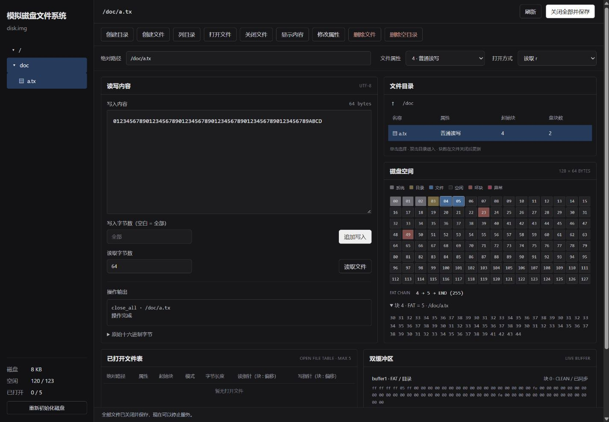

# 深色界面改版验收

日期：2026-11-18。

## 修改范围

根据确认的 Harness 风格原型重排 HTML/CSS：深灰工作区、目录侧栏、紧凑工具栏、读写区、目录及盘块区、打开文件表、双缓冲和可展开日志。保留全部按钮、打开表字段和可输入数值的写入长度。操作提示移至底部状态栏。

前端增加侧栏文件选择、创建后显示父目录等展示联动；请求地址、请求字段、后端接口及文件系统核心未修改。ApiController.java 改版前后 SHA-256 均为 C2C9C0F4CBDD3134F88A5CC0140B4494E075493E95695BE623661208524068DB。

## 实际测试

- Maven package 成功：23 项测试，0 失败、0 错误、0 跳过（22 个核心用例实例＋1 个扩展 HTTP 流程）。
- HTTP 流程覆盖全部 11 项操作、状态和块查询、初始化确认、跨块读写、中文追加、只读与打开状态限制、非法操作、目录和盘块回收。
- 浏览器实际完成创建目录/文件、64 字节跨块写入、关闭、完整读取、盘块十六进制查询、关闭全部并保存；显示结果与输入一致。
- 1440×1000 桌面和 390×844 窄屏检查完成，窄屏 document scrollWidth 与 clientWidth 均为 375（扣除滚动条后），无整页横向溢出。浏览器错误日志为空。
- node --check app.js 通过；最终 release JAR 的 --self-test 输出 PASS。
- 正式服务先保存文件再更换运行包；保存后的镜像备份至 target/disk-before-ui-upgrade.img。重启后从只读块接口逐块重建校验，SHA-256 与备份一致。直接外部读镜像被 Windows 独占锁拒绝，因此使用块接口校验。
- 独立验收服务 8082 已停止；正式新版服务位于 http://127.0.0.1:8080 。

原始 Maven 结果见 test-results/2026-11-18-dark；正式运行包 SHA-256：F315D0B9C1F50E54C3C99FB29B0BCBF4556F2B9B77B201315AFE48DE1B16A373。

## 实际界面

## 使用说明变化

旧手册所说“顶部提示”现在位于底部状态栏；创建、打开等按钮集中在顶部工具栏；目录树包含文件选择。按钮名称、路径输入、读写及关闭顺序均未改变。历史测试记录中的旧 JAR 校验和与旧截图只对应旧版本，以本记录为本次改版证据。
