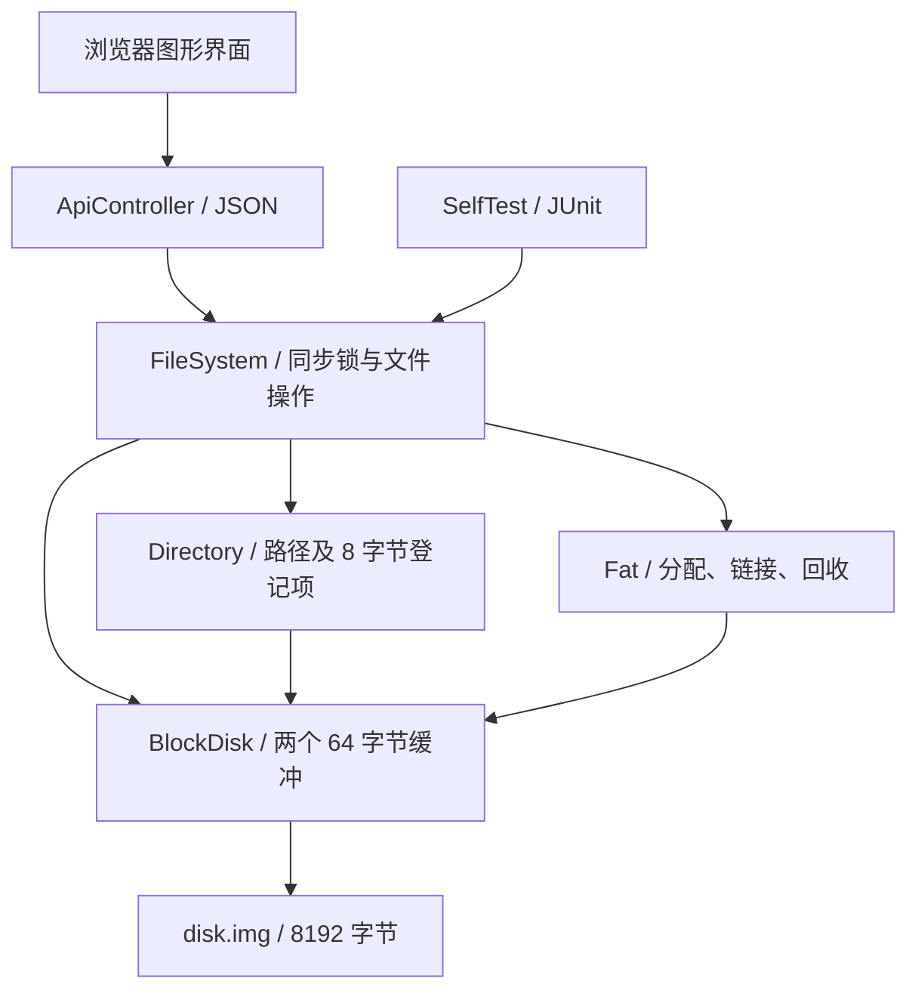
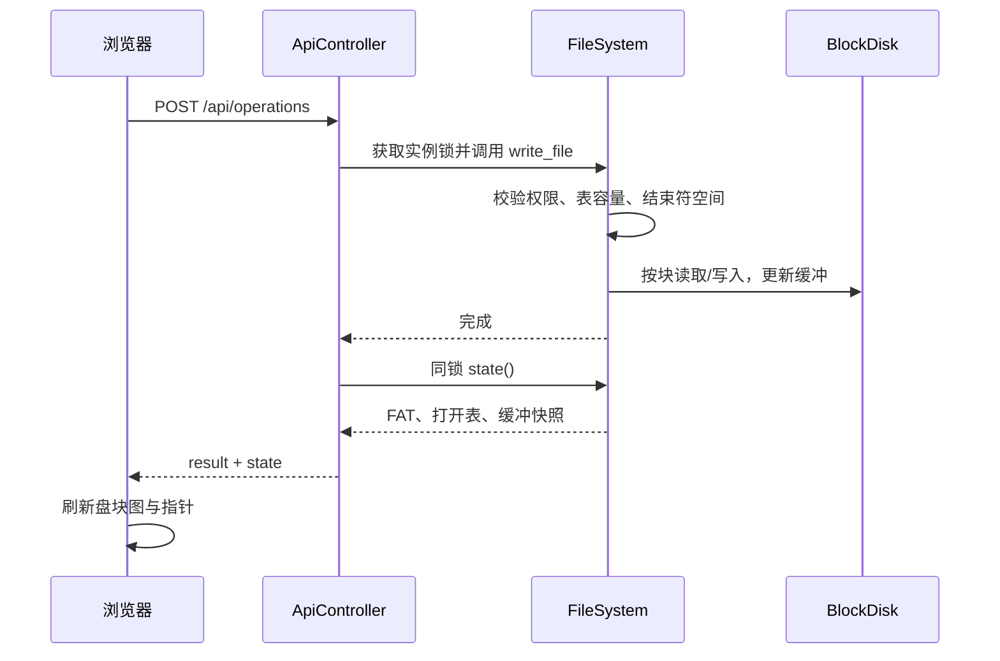
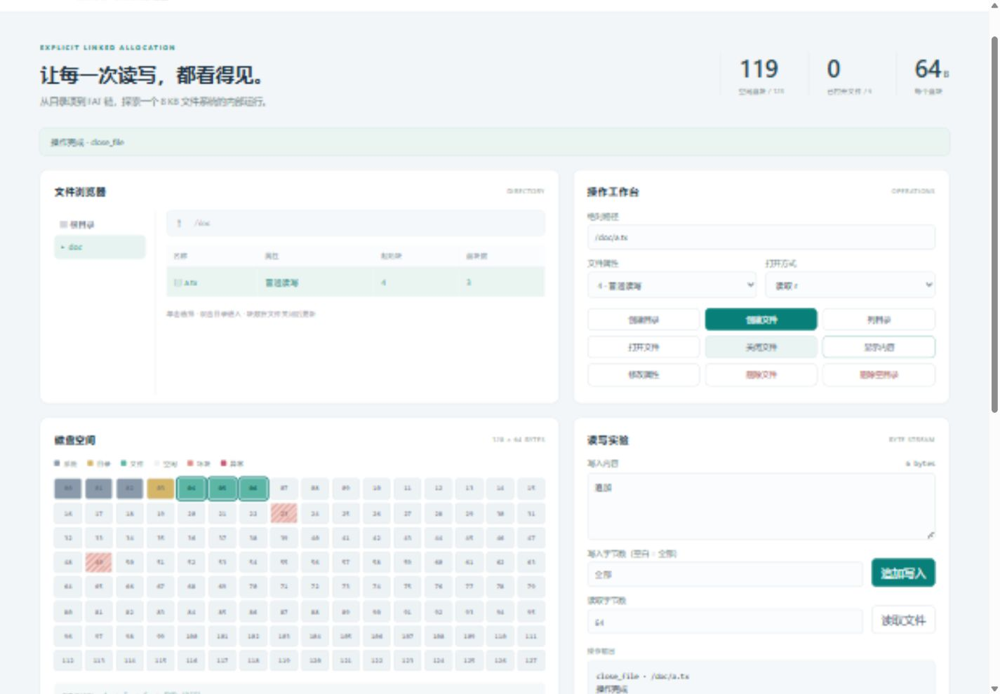

# 《操作系统分析与设计实习》课程设计报告

**题目：模拟磁盘文件系统实现**  
**项目名称：FAT Lab**  
**学年学期：2026 学年第一学期**  
**学号、姓名、班级、指导教师：待本人填写**

| 小组成员 | 学号 | 实际分工 | 工作量比例 |
|---|---|---|---|
| 待填写 | 待填写 | 按实际情况填写 | 待填写 |

> 正式提交时，按指导书将学校成绩单作为首页。个人体会、成员分工和自我评价必须由参与者依据实际情况填写。本报告记录软件设计及已执行的验证，不代写虚构个人经历。

## 一、需求分析

### 1. 任务与边界

使用普通文件模拟小型磁盘，以显式链接 FAT 组织流式文件，实现图形界面的目录和文件操作。用户可观察盘块、分配链、两个缓冲区和打开文件表，从可见结果解释操作系统文件管理原理。

文件系统操作只针对配置的镜像文件，不访问真实磁盘分区。支持多级绝对路径，不支持相对路径、任意长目录、文件中间修改。单机服务仅监听回环地址，不包含用户认证和远程协作。

### 2. 输入、输出与约束

| 对象 | 输入范围/规则 | 输出 |
|---|---|---|
| 磁盘 | 128 块，每块 64 字节，共 8192 字节 | 128 块状态及 FAT 值 |
| 名称 | ASCII 主体 1～3 字节；扩展名可省略或为 1～2 字节 | 目录列表 |
| 路径 | 从 / 开始，父目录必须已存在 | 登记项或明确错误 |
| 目录 | 每目录 1 块、最多 8 项，文件目录混合登记 | 树形路径与项目列表 |
| 文件内容 | UTF-8 字节序列，# 为保留结束符 | 文本、字节数、十六进制 |
| 读长度 | 0～8192 整数，遇文件末尾提前停止 | 实际读取内容与指针 |
| 写长度 | 0～输入内容字节数，未填表示全部 | FAT 链增长及写指针 |
| 属性 | 4 普通读写、5 普通只读、2 系统读写、3 系统只读 | 属性提示与权限控制 |
| 打开表 | 最多 5 项，r 或 w | 路径、属性、起始块、长度、双指针 |

目录项首字节 `$` 表示空项。名称区分大小写；同一父目录不允许相同完整名称。创建只读文件、写只读文件、删除已打开文件等非法操作必须失败。正常启动不得覆盖已有磁盘。

### 3. 需求测试数据

有效输入：`/doc/a.tx` 写入 128 个 ASCII 字符，应占 3 块；连续读取 64 字节两次应完整恢复内容；关闭后追加两个汉字应增加 6 字节。

错误输入：相对路径 `doc/a.tx`、超过长度的 `/long.tx`、含结束符的写入 `abc#`、第六个同时打开文件、向已满目录创建第九项。预期返回规则错误，不执行部分业务修改。

## 二、概要设计

### 1. 技术与模块

Java 21、Spring Boot 3.5.16、Maven；页面为原生 HTML/CSS/JavaScript。Spring Boot 负责静态页面与 HTTP 转发，核心不依赖 Spring，可直接由主函数调用。



### 2. 主要抽象数据类型

| 类型 | 字段 | 责任 |
|---|---|---|
| BlockDisk | RandomAccessFile、文件锁、buffer1、buffer2 | 64 字节定位读写、独占镜像 |
| Buffer | byte[64]、block、dirty、name | 缓冲切换、脏数据写回 |
| Fat | BlockDisk 引用 | 获取/更新 FAT 项、链遍历、分配与释放 |
| Entry | name、attribute、start、length、parent、slot | 解码后的目录项；目录盘块和槽号定位原登记项 |
| OpenFile | Entry、mode、length、read | 打开状态；写位置等于内容字节长度 |
| FileSystem | 磁盘、目录、FAT、LinkedHashMap 打开表、日志 | 跨模块业务规则及同步 |

打开表使用有序映射实现最多 5 项登记，等价于有界表，查找路径便于判断重复打开。读指针内部保存字节偏移，对外换算盘块和块内位置；写指针使用文件长度表达追加位置。文件末尾必有已分配的结束符空间，因此指针总能映射到合法盘块。

### 3. 磁盘格式

| 块号 | 内容 |
|---|---|
| 0～1 | FAT 的 128 个单字节项 |
| 2 | 根目录 8 个登记项 |
| 23、49 | 坏块，FAT 值 254 |
| 其余 3～127 | 可分配区，共 123 块 |

FAT：0 空闲，255 链尾，254 坏块，其余合法数据块号表示后继。系统块 0、1、2 初始标记 255。Java byte 为有符号值，读取 FAT 使用 `Byte.toUnsignedInt`，防止把 255 当作 -1 参与索引。

文件登记项按“3 字节主体＋2 字节扩展名＋1 字节属性＋1 字节起始块＋1 字节块数”保存。短名称空格补齐。目录登记项扩展名位置为空格，最后一字节为 0，属性为 8。

### 4. 主流程

启动 → 检查镜像是否存在 → 不存在则等待用户初始化；存在则校验加载 → 提供页面 → 接收操作 → 获取核心锁 → 参数及权限校验 → 操作核心 → 返回同锁状态快照 → 更新页面。正常停止调用 close_all，保存所有写文件后释放文件锁。

## 三、详细设计

### 1. 缓冲与块访问算法

```text
LOAD(buffer, block):
    拒绝 block 不在 0..127
    如果另一缓冲持有 block：写回另一缓冲，令其块号无效
    如果 buffer 的当前块不是 block：
        若脏则定位 currentBlock * 64，写回 64 字节
        定位 block * 64，完整读取 64 字节至 buffer
        设置当前块为 block
    返回 buffer 的数组
FLUSH(buffer):
    如果 dirty：定位当前块并写 64 字节，清除 dirty
```

缓冲复用前必须写回。数据缓冲写到第 63 偏移后立即刷回；关闭文件时不足整块的尾部也刷回。两个缓冲区跨用途复用同一块时须使旧缓冲失效，否则回收后重分配的目录块可能被旧文件缓存覆盖。

状态面板按块直接查看镜像，若块已在缓冲中则返回缓冲副本。它不使用 LOAD，不改变脏标志。界面刷新因而不会偷偷替用户提交写文件。

### 2. FAT 算法

```text
ALLOCATE:
    从 3 到 127 扫描，排除 23、49
    找到 FAT[i] == 0：置 FAT[i] = 255，返回 i
    没有空闲块：失败
CHAIN(start):
    result = 空列表；seen = 空集合；current = start
    循环：检查 current 是合法数据块且不在 seen
        加入 seen 和 result
        next = FAT[current]
        若 next == 255：返回 result
        current = next
RELEASE(start):
    先完整验证并取得链，再将每项 FAT 清零
```

先遍历再释放，避免途中发现循环后已经回收一部分块。非法指针、坏块、系统块不会被释放。

### 3. 目录与路径算法

```text
RESOLVE(path):
    校验规范绝对路径；若为 / 返回根目录
    current = 根目录
    对每个路径分量：
        current 必须为目录
        读取 current 块，逐个比较最多 8 个非空登记项的完整名称
        未命中则失败；命中则 current = 命中项
    返回 current
MD(path):
    校验名称、父目录、重名、空槽、磁盘空间
    分配一块；将 8 个槽首字节置为 $
    写父目录登记项；刷回
DIR(path): 校验目录，解码并返回 8 个槽中的有效登记项
RD(path):
    拒绝根目录、文件和非空目录
    回收目录块；父目录登记项首字节置 $；刷回
```

指导书删除空目录段落末句出现“若是非空子目录，则删除”，与前文明确禁止非空目录冲突，本实现按操作名称及前文采用“只删除空目录”。前文要求多级目录，末尾又列作扩展，本实现选择支持多级目录并保持每目录一块。

### 4. 文件操作算法

```text
CREATE_FILE(path, attribute):
    验证非只读属性、打开表空位、父目录、名称、重名、空槽、空闲块
    分配块，清零并写初始 #；登记文件长度 1 块
    添加写模式打开项，长度 0、读位置 0；刷回
OPEN_FILE(path, mode):
    验证 r/w、存在性、非目录、只读权限
    已打开同模式则返回；异模式则失败
    表满则失败；逐块找到 #，计算内容字节长度
    登记打开项，读位置 0，写位置等于字节长度
READ_FILE(path, count):
    验证 count；自动读打开
    n = min(count, 文件长度 - 当前读位置)
    沿 FAT 取当前块，通过 buffer2 读取 n 字节，跨块时切换
    读位置 += n；返回文本及原始字节
WRITE_FILE(path, bytes, count):
    验证长度、#、权限、打开模式及表容量
    old = 打开表长度或扫描 # 的结果
    required = ceil((old + count + 1) / 64)
    若 required - 当前块数 > 空闲数：拒绝，不改变文件或打开表
    自动写打开；分配并链接所需新块
    从 old 位置逐字节写入 buffer2；块满时刷回
    更新打开表长度为 old + count
CLOSE_FILE(path):
    未打开则返回
    若写模式：在 length 位置写 #，目录项块数更新为链长
        刷回两个缓冲并同步文件描述符
    删除打开表项
DELETE_FILE(path):
    验证文件存在且关闭；回收整链；删除登记项；刷回
TYPEFILE(path):
    验证文件存在且关闭；沿链读取至 #；输出内容，不登记打开表
CHANGE(path, attribute):
    验证属性及文件关闭；更新属性字节；刷回
```

关闭写文件承担结束符与目录长度提交。对常见参数、权限、容量错误先校验后修改；对于底层写失败、进程强杀或断电，没有事务日志，不能宣称有完整恢复能力。

### 5. 同步与 HTTP 调用关系



并发 HTTP 请求由核心实例锁串行化。前端 busy 标志防止同页面重复点击；核心锁处理多页面和多线程的并发。没有模拟 CPU 或进程调度，属于题目一范围。

### 6. 加载校验与初始化

初始化先创建完整临时镜像，写入各块后再替换目标镜像；必须传入明确确认且打开表为空。现有镜像加载时检查：长度 8192、系统和坏块 FAT、每条链的合法性、目录项名称和属性、目录链长度、文件块数与结束符位置、跨文件共享块、循环目录、孤立分配块。校验失败关闭镜像并显示错误，不自动修复或格式化。

## 四、调试分析

### 1. 已实际遇到的问题

| 问题 | 原因与处理 |
|---|---|
| Maven 无法写入默认本地仓库 | 本机 Maven 配置指向项目外目录；改用项目 `.m2`，不修改全局设置 |
| 第一轮测试 21 项中 2 项外部读取镜像失败 | Windows 独占文件锁阻止另一个句柄读取；调整测试为关闭镜像后读取、再重新加载 |
| 回收盘块跨用途重用可能保留旧缓存 | 检查共享缓冲逻辑时发现；新增“加载前刷回并使另一缓冲同块缓存失效”，增加回归用例 |
| 沙箱环境拒绝回环连接和临时文件重命名 | 属于执行环境限制；在获准的正常本机环境重新运行完整测试 |
| 浏览器控制在原生 confirm 处出现超时 | 检查当前弹窗并接受后继续观察页面；最终初始化和两次删除均显示成功，不把工具超时计作核心测试失败 |

### 2. 时间与空间复杂度

设磁盘块数 B=128，目录深度 D，文件链长 K，读写字节数 N。

- 路径查找每层最多比较 8 项，O(8D)，即 O(D)。
- 一次空闲块分配顺序扫描 FAT，O(B)。增加 M 块最坏 O(MB)，小型教学磁盘可接受。
- 链验证与释放 O(K)；文件长度扫描 O(64K)；读写 O(K+N)，含额外分配时 O(K+N+MB)。
- 启动检查遍历所有登记项和已分配链，规模受 B 限制；快照用于教学，按块读取，有较多小 I/O，不面向生产性能。
- 常驻磁盘缓冲共 128 字节，另有最多 5 项打开表、有限日志、链集合和界面 DTO。输出某个文件时允许分配该文件内容数组，不缓存整张磁盘。

### 3. 设计取舍与改进

固定目录和短 ASCII 名称便于准确实现 8 字节磁盘格式；UTF-8 内容则支持日常中文演示。禁止内容 `#` 避免结束符歧义。写前空间检查保证普通容量失败不产生半次追加，代价是扫描空闲空间。

可改进方向包括可变长目录、相对路径、位图/空闲链优化、日志事务与异常恢复。生产文件系统还需处理崩溃一致性、权限隔离、原子提交及更完整的损坏恢复，本课设未实现。

个人学习心得及小组协作体会：**由本人据实补充**。

## 五、用户使用说明

运行 `start.cmd`，首次初始化磁盘。路径填 `/doc` 创建目录，再填 `/doc/a.tx` 创建文件；输入内容并追加写入，关闭文件后显示内容或重新读打开。实验完成点击“关闭全部并保存”，运行 `stop.cmd`。完整输入范围、按钮说明和故障处理见同目录《操作手册》。

启动脚本检查 Java 版本和端口，后台运行已打包 JAR 并等待 HTTP 就绪。停止脚本核对 PID 与本项目 JAR 路径，先请求关闭全部文件，再结束自己的 Java 进程。脚本不结束占用相同端口的其他程序。

## 六、测试与运行结果

验证环境：Windows，Java 21.0.8，Maven 3.9.11，Spring Boot 3.5.16。2026-11-17 执行完整 Maven 测试：**23 项，0 失败、0 错误、0 跳过**，JAR 打包成功。独立 `--self-test` 输出 PASS。核心与 API 测试使用独立临时镜像，浏览器使用 `target/browser-test/disk.img`。

| 场景 | 实际结果 |
|---|---|
| 0、1、63、64、127、128、250 字节写入、关闭、重启、追加 | 参数化测试全部通过 |
| 空间耗尽与非法 # 输入 | 拒绝写入，关闭后镜像字节比较不变 |
| 目录与权限、打开表、连续读、UTF-8 部分字符 | 自动化测试通过 |
| 多文件交替写入、回收块跨用途重用 | 回归测试通过 |
| 4 线程提交 30 次追加及快照 | 最终长度 90 字节，通过 |
| 循环链、共享块、非法指针、缺结束符、坏块标记、孤立块、镜像长度错误 | 拒绝加载且未覆盖 |
| HTTP 页面、初始化、创建、写入、关闭、显示、非法操作 | 集成测试通过 |
| 浏览器写 128 字节 | FAT 链 4→5→6，目录块 3；剩余 119 块 |
| 浏览器连续读两次，每次 64 字节 | 首次指针 5:0，后续读出剩余内容 |
| 浏览器追加“追加” | UTF-8 增加 6 字节，总长 134，显示内容正确 |
| 浏览器删除文件及空目录 | 空闲块先恢复 122，再恢复 123 |

### 实际运行截图



图 1：真实桌面视口画面，文件占 3 块，FAT 链高亮。浏览器截图工具捕获存在缩放，精确数值以测试记录和界面文本核对为准。


图 2：删除文件和空目录后，根目录为空、空闲数 123、打开数 0；同时展示窄屏布局。

原始自动化报告保存在 `docs/test-results`。本报告不将尚未执行的断电恢复、任意操作系统兼容性或远程部署列为通过项。
